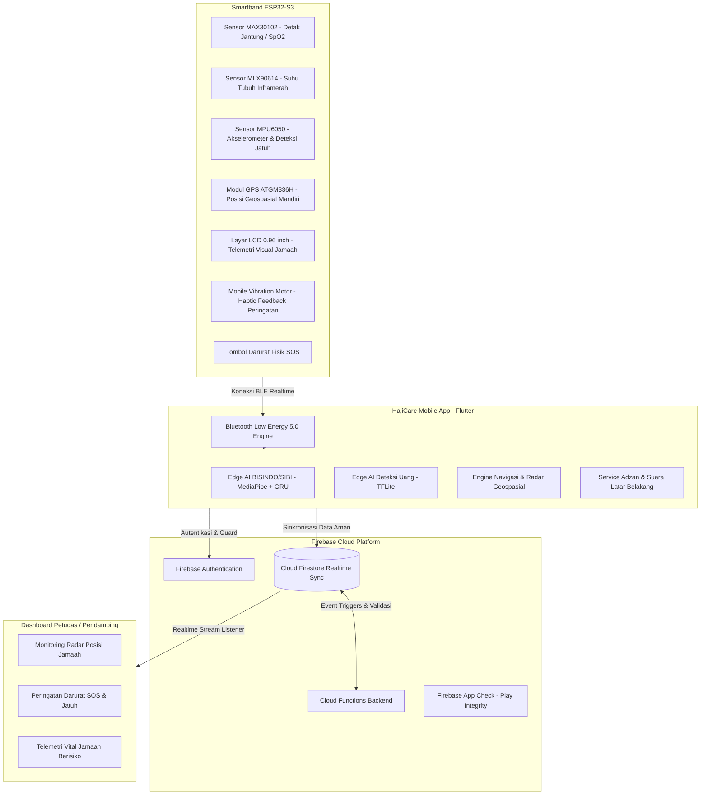

# HajiCare: Ekosistem Cerdas Pendamping & Monitoring Jamaah Haji / Umrah

<div align="center">


### *Inovasi Terpadu Berbasis IoT Smartband, Edge AI Aksesibilitas, dan Pemantauan Geospasial Real-Time untuk Jamaah Haji dan Lansia*

[](https://flutter.dev)
[](https://dart.dev)
[](#)
[](#)
[](https://firebase.google.com)
[](https://www.tensorflow.org/lite)
[](https://www.espressif.com)
[](LICENSE)
[](#)

</div>

---

## 📌 Ringkasan Eksekutif (Executive Summary)

Ibadah Haji dan Umrah merupakan ibadah fisik yang melibatkan lebih dari **2,5 juta jamaah dari seluruh penjuru dunia** di satu kawasan geografis yang padat (Makkah, Madinah, Mina, Arafah, Muzdalifah). Mayoritas jamaah Indonesia tergolong **lanjut usia (lansia)** dan sebagian memiliki **disabilitas sensorik (rungu/wicara/netra)**.

Tantangan di lapangan meliputi:
1. **Risiko Tersesat**: Jamaah terpisah dari rombongan di tengah lautan jutaan manusia tanpa koneksi internet yang stabil.
2. **Kondisi Kesehatan Kritis**: Suhu ekstrem gurun pasir (>45°C) memicu dehidrasi mendadak, kelelahan fisik, hingga serangan jantung (*heatstroke* dan henti jantung mendadak).
3. **Keterbatasan Komunikasi & Aksesibilitas**: Hambatan bahasa antara jamaah Indonesia/disabilitas rungu dengan petugas lokal Arab Saudi, serta kesulitan mengenali nominal mata uang Riyal (SAR).
4. **Keterlambatan Penanganan Darurat**: Ketiadaan tombol panik yang terhubung langsung secara real-time ke posko pendamping dan tim medis.

**HajiCare** hadir sebagai solusi komprehensif yang mengintegrasikan **aplikasi mobile cerdas** dengan **gelang pintar (IoT Smartband)** untuk mendampingi jamaah secara preventif, adaptif, dan responsif.

---

## 🌟 4 Pilar Solusi Inovatif

<div align="center">

</div>

### 1. ⌚ Smart IoT Wearable (Gelang Pintar ESP32-S3)
Gelang pintar nirkabel berdaya rendah (*Bluetooth Low Energy / BLE 5.0*) yang dikenakan oleh jamaah di pergelangan tangan:
- **Pelacak Lokasi Mandiri (Modul GPS ATGM336H)**: Modul positioning dual-mode (BDS + GPS) sensitivitas tinggi untuk melacak koordinat geospasial jamaah secara akurat bahkan saat terpisah dari smartphone.
- **Detak Jantung & SpO2 (Sensor MAX30102)**: Memantau denyut nadi dan saturasi oksigen secara berkala untuk deteksi dini aritmia dan hipoksia.
- **Suhu Tubuh Inframerah (Sensor MLX90614)**: Mengukur suhu tubuh akurat tanpa kontak langsung guna mendeteksi gejala *heat exhaustion* sebelum terjadi *heatstroke*.
- **Deteksi Jatuh & Akselerometer (Sensor MPU6050)**: Mendeteksi benturan atau kondisi jatuh tiba-tiba pada jamaah lansia secara otomatis.
- **Layar Tampilan Informasi (Layar OLED / LCD 0.96")**: Menampilkan visualisasi data vital secara langsung di pergelangan tangan (detak jantung BPM, suhu tubuh, status baterai, koneksi GPS, dan jam) tanpa perlu membuka HP.
- **Umpan Balik Haptik (Mobile Vibration Motor)**: Memberikan getaran peringatan darurat instan saat jamaah keluar dari batas radius aman (*safe radius*), notifikasi waktu ibadah, dan konfirmasi penekanan SOS.
- **Tombol Darurat Fisik (Hardware SOS Button)**: Tombol taktil yang dapat ditekan jamaah saat darurat tanpa perlu membuka smartphone.

### 2. 🤖 Edge AI & Aksesibilitas Disabilitas (Bekerja 100% Offline)
Solusi kecerdasan buatan terpasang (*on-device AI*) yang berjalan langsung di HP jamaah tanpa bergantung pada sinyal internet:
- **Penerjemah Bahasa Isyarat Dua Arah (BISINDO & SIBI)**:
  - *Sign-to-Text*: Kamera mengenali gerakan bahasa isyarat melalui ekstraksi titik koordinat (*MediaPipe Landmark*) dan inferensi *Recurrent Neural Network (Motion GRU)*.
  - *Text-to-Sign*: Mengonversi teks atau perintah suara petugas menjadi video animasi bahasa isyarat beresolusi tinggi yang telah tersimpan di memori perangkat.
- **Pendeteksi Nominal Uang Cerdas (Saudi Riyal & Rupiah)**:
  - Menggunakan model *MobileNet / YOLO TFLite* untuk mengenali nominal uang kertas dan koin Riyal (SAR) maupun Rupiah (IDR).
  - Dilengkapi konversi suara otomatis (*Text-to-Speech*) dan estimasi kurs real-time, melindungi jamaah dari salah bayar atau penipuan.

### 3. 📍 Smart Room & Radar Geospasial Real-Time
- **Sistem Kamar & Rombongan (Room Grouping)**: Jamaah dan pendamping terhubung dalam satu *Room* privat via kode unik atau pemindaian QR Code.
- **Radar Pendamping Terdekat**: Menghitung jarak geospasial real-time antara jamaah dan petugas terdekat.
- **Geofencing & Dynamic Safe Radius**: Sistem otomatis memberi peringatan getar dan notifikasi audio jika jamaah keluar dari radius aman yang ditentukan pendamping (misal: radius 100 meter saat di Masjidil Haram).

### 4. 🕋 Pendamping Ibadah Digital & Penanganan Darurat
- **Panduan Manasik & Doa Interaktif**: Alur tahapan haji dari Ihram, Thawaf, Sa'i, Wukuf, hingga Tahallul dengan teks Arab, transliterasi, arti, dan audio panduan.
- **Waktu Shalat & Adzan Akurat**: Perhitungan hisab posisi lintang/bujur Makkah & Madinah dengan alarm adzan latar belakang yang andal.
- **Kompas Kiblat Astrolabe**: Navigasi arah Ka'bah berbasis sensor giroskop dan magnetik kompas ponsel.
- **Sistem Tanggap Darurat (Emergency SOS Dispatch)**: Satu sentuhan tombol SOS memancarkan sinyal darurat, titik koordinat GPS, serta histori tanda vital jamaah ke seluruh dashboard pendamping di area tersebut.

---

## 📱 Matriks Fitur Lengkap Aplikasi

Berikut adalah rincian seluruh modul fitur yang terimplementasi di dalam aplikasi HajiCare:

| Kategori | Fitur Unggulan | Deskripsi & Manfaat |
| :--- | :--- | :--- |
| **🧕 Khusus Jamaah** | **Live Status Monitoring Card** | Menampilkan status koneksi GPS, jarak geospasial ke posko, dan indikator keamanan (Aman, Waspada, Di Luar Radius). |
| | **Fitur "Jemput Saya" (Quick Assistance)** | Mengirim permintaan bantuan cepat ke pendamping cukup 1 klik saat jamaah kelelahan, tersesat, atau butuh kursi roda. |
| | **Bento Services Grid** | Menu navigasi modular satu ketukan untuk mengakses penerjemah isyarat, deteksi uang, jadwal shalat, dan doa. |
| | **Emergency Hotline Terintegrasi** | Panggilan darurat langsung ke Ambulans Saudi (997), Polisi (999), dan Call Center Haji Indonesia Kemenag. |
| **🛡️ Khusus Pendamping** | **Radar Monitoring Rombongan** | Radar visual interaktif yang memetakan persebaran dan posisi seluruh jamaah di sekitar posko secara real-time. |
| | **Dynamic Geofencing Slider** | Pengaturan batas radius aman fleksibel (50m - 1000m) yang disesuaikan dengan kondisi area (Masjidil Haram vs Mina). |
| | **Smart Room Management** | Pembuatan dan pengelolaan kamar rombongan dengan kode 6-digit acak serta QR Code untuk kemudahan bergabung. |
| | **Konsol SOS Dispatcher** | Menerima peringatan darurat instan disertai koordinat GPS akurat, visualisasi rute tercepat, dan data tanda vital jamaah. |
| **🤖 Edge AI Aksesibilitas** | **Sign-to-Text (BISINDO & SIBI)** | Pengenalan gerakan tangan via kamera menggunakan MediaPipe 543 Landmarks dan model Recurrent Neural Network Bi-GRU. |
| | **Text / Voice-to-Sign** | Kamus video bahasa isyarat beresolusi tinggi offline yang diputar mulus via ExoPlayer native tanpa jeda buffering. |
| | **Deteksi Uang Cerdas (SAR & IDR)** | Klasifikasi nominal uang kertas dan koin Riyal serta Rupiah berbasis model TFLite dilengkapi bounding box visual. |
| | **Audio Voice Feedback (TTS)** | Suara pembacaan otomatis nominal uang dan hasil kalkulasi kurs untuk membantu jamaah tunanetra dan lansia. |
| **⌚ IoT Smartband ESP32-S3** | **Telemetri Vital 4-Sensor** | Pembacaan detak jantung & SpO2 (MAX30102), suhu tubuh (MLX90614), akselerometer jatuh (MPU6050), dan GPS ATGM336H. |
| | **Notifikasi Haptik Bergetar** | Getaran otomatis saat jamaah keluar dari radius aman atau saat waktu shalat tiba via Mobile Vibration Motor. |
| | **Layar Pergelangan Tangan 0.96"** | Menampilkan data vital mandiri (denyut nadi, suhu tubuh, baterai, GPS, dan waktu) langsung di gelang tanpa buka ponsel. |
| | **Offline Sensor Persistence** | Penyimpanan riwayat telemetri di storage lokal perangkat saat koneksi internet terputus. |
| **🕋 Spiritual & Navigasi** | **Kumpulan Doa Haji & Umrah** | Doa lengkap bertahap (Ihram, Tawaf, Sa'i, Wukuf, Jumrah, Tahallul) teks Arab, Latin, arti, dan audio tilawah. |
| | **Background Adzan Service** | Alarm adzan otomatis yang berjalan di latar belakang (Foreground Service) dan kebal terhadap *battery saver* Android. |
| | **Kompas Kiblat Astrolabe** | Penunjuk arah Ka'bah presisi berbasis perpaduan sensor geomagnetik dan komputasi lintang/bujur. |
| | **Peta POI & Routing Pejalan Kaki** | Peta interaktif Makkah & Madinah dengan rute pejalan kaki serta penanda Posko Kesehatan Haji Indonesia dan hotel. |

---

## 🏗️ Arsitektur Sistem

Berikut adalah alur komunikasi data antara perangkat fisik jamaah, smartphone, cloud database, dan dashboard pendamping:



---

## 🌐 Daftar API & Integrasi Layanan Eksternal

Aplikasi HajiCare mengintegrasikan berbagai API standar industri dengan pendekatan **Offline-First & Resilient Fallback**:

| Nama API / Layanan | Penyedia / Sumber | Endpoint / Fungsi Utama | Mekanisme Fallback / Offline |
| :--- | :--- | :--- | :--- |
| **OpenRouteService API** | Heidelberg Institute (HeiGIT) | `api.heigit.org/openrouteservice/v2/directions/foot-walking` — Kalkulasi rute dan jarak navigasi jalan kaki di kawasan Makkah. | Otomatis beralih (*graceful fallback*) ke Public OpenStreetMap Routing (`routing.openstreetmap.de`) jika kuota limit atau offline. |
| **Nominatim Geocoding API** | OpenStreetMap Foundation | `nominatim.openstreetmap.org/search` — Pencarian alamat, gedung hotel, dan konversi koordinat GPS ke teks alamat. | Didukung oleh Komoot Photon API (`photon.komoot.io`) dan Android Native Geocoder lokal. |
| **Overpass API (OSM Data)** | OpenStreetMap Project | `overpass-api.de/api/interpreter` — Ekstraksi Point of Interest (POI) posko kesehatan, masjid, pos keamanan, dan toilet. | Hasil query disimpan dalam cache memori lokal sehingga dapat diakses tanpa query ulang berulang kali. |
| **Open Exchange Rates API** | Open Exchange Rates Inc. | `open.er-api.com/v6/latest/USD` — Pengambilan kurs konversi valuta asing terkini (SAR ke IDR dan USD). | Menggunakan nilai kurs konversi lokal yang tersimpan di `SharedPreferences` jika perangkat tidak memiliki internet. |
| **Cloud Firestore API** | Google Cloud Platform | Sinkronisasi dua arah real-time data kamar rombongan, koordinat anggota, dan siaran alarm darurat SOS. | Dilengkapi fitur *offline persistence cache* lokal bawaan Firestore SDK. |
| **Firebase Auth & Credential Manager** | Google Identity Platform | Pengelolaan akun pengguna, login Google satu ketukan (*Google Credential Manager v7*), dan proteksi berbasis role. | Token sesi disimpan secara terenkripsi dalam *Android Keystore* (`flutter_secure_storage`). |
| **Firebase App Check API** | Google Play Integrity | Menjamin setiap request ke server backend hanya berasal dari aplikasi resmi HajiCare yang valid dan tidak dimodifikasi. | Mode debug provider khusus untuk pengujian lokal developer. |
| **Firebase Cloud Functions** | Google Cloud Serverless | Backend komputasi tanpa server untuk operasi kritis, validasi kode room, dan broadcast push notification. | Fallback penulisan langsung ke koleksi Firestore berkeamanan tinggi jika fungsi sedang *cold-start*. |
| **CartoDB & OSM Map Tiles API** | CartoDB & OpenStreetMap | `basemaps.cartocdn.com` & `tile.openstreetmap.org` — Penyedia ubin peta vektor tampilan terang (Voyager) dan gelap (Dark All). | Tile peta di-cache ke dalam penyimpanan penyimpanan lokal ponsel melalui `flutter_map`. |
| **Google ML Kit Translation API** | Google Machine Learning | Penerjemahan teks dwibahasa (Arab $\leftrightarrow$ Indonesia) secara langsung di perangkat. | Model bahasa diunduh satu kali ke penyimpanan lokal dan bekerja 100% offline tanpa internet. |
| **Adhan Calculation Engine** | Umm al-Qura Univ. / MWL | Komputasi hisab astronomis posisi matahari untuk penentuan waktu shalat Subuh, Dzuhur, Ashar, Maghrib, dan Isya. | Algoritma matematis murni terpasang (*built-in*), tanpa perlu koneksi internet untuk menghitung jadwal shalat. |

---

## 💻 Spesifikasi Teknologi (Tech Stack)

| Komponen | Teknologi | Keterangan |
| :--- | :--- | :--- |
| **Framework Utama** | Flutter 3.x & Dart 3.x | Multiplatform dengan rendering performa tinggi 60 FPS |
| **Manajemen State** | GetX (Reactive Architecture) | Arsitektur reaktif bersih memisahkan UI, logika bisnis, dan data |
| **Hardware IoT Smartband** | ESP32-S3 Microcontroller | Dual-core Xtensa LX7, BLE 5.0 nirkabel hemat daya |
| **Sensor & Modul Fisik** | ATGM336H GPS, MAX30102, MLX90614, MPU6050, LCD 0.96", Mobile Motor | Telemetri kesehatan lengkap, pelacakan posisi mandiri, dan notifikasi getar |
| **Edge Machine Learning** | TensorFlow Lite (`tflite_flutter`) | Model GRU terkuantisasi (float16) untuk efisiensi memori & daya |
| **Penglihatan Komputer** | MediaPipe Holistic Landmarks | Ekstraksi 543 koordinat gerak tangan, tubuh, dan wajah |
| **IoT & Komunikasi Nirkabel** | `flutter_blue_plus` (BLE 5.0) | Protokol transmisi biner karakteristik kustom GATT ESP32 |
| **Peta & Geospasial** | `flutter_map`, OpenStreetMap | Navigasi peta vektor interaktif dengan caching offline |
| **Cloud Database** | Cloud Firestore & Firebase Auth | Sinkronisasi data real-time latensi rendah dengan aturan keamanan ketat |
| **Keamanan Aplikasi** | Firebase App Check & Keystore | Proteksi integritas aplikasi dan enkripsi lokal data sensitif |

---

## 📋 Prasyarat Sistem (Prerequisites)

Sebelum menjalankan aplikasi, pastikan perangkat pengembangan Anda telah terinstal:

1. **Git** (versi terbaru)
2. **Flutter SDK** (versi `^3.11.1` atau lebih baru)
   ```bash
   flutter --version
   ```
3. **Android Studio** atau **VS Code** dengan ekstensi Flutter & Dart
4. **Java Development Kit (JDK 17)**
5. **Perangkat Fisik Android**:
   - OS Android 8.0 (Oreo / API 26) ke atas.
   - Mendukung Bluetooth Low Energy (BLE) dan GPS Lokasi.

---

## 🚀 Panduan Instalasi Langkah Demi Langkah (Step-by-Step)

### 1. Kloning Repositori
Buka terminal dan unduh repositori HajiCare ke komputer lokal Anda:
```bash
git clone https://github.com/riverry25/hajicare.git
cd hajicare
```

### 2. Unduh Dependensi Proyek
Jalankan perintah berikut untuk mengunduh seluruh dependensi Flutter yang didefinisikan pada `pubspec.yaml`:
```bash
flutter pub get
```

### 3. Konfigurasi Firebase (Opsi Default / Kustom)
Aplikasi HajiCare telah dilengkapi template konfigurasi Firebase:
- File `lib/firebase_options.example.dart` tersedia sebagai panduan.
- Untuk menghubungkan ke project Firebase Anda sendiri:
  ```bash
  # Instal FlutterFire CLI jika belum tersedia
  dart pub global activate flutterfire_cli

  # Konfigurasikan project
  flutterfire configure
  ```

### 4. Pengecekan Kualitas Kode
Pastikan seluruh file kode dalam kondisi optimal tanpa peringatan atau kesalahan sintaks:
```bash
flutter analyze
```
*(Hasil verifikasi harus menampilkan `No issues found!`)*

### 5. Menjalankan Aplikasi pada Perangkat
Hubungkan smartphone Android Anda via kabel USB (pastikan *USB Debugging* aktif), kemudian jalankan:
```bash
# Menjalankan dalam mode Debug
flutter run

# Atau menjalankan dalam performa rilis maksimal (Recommended untuk demo)
flutter run --release
```

---

## 📁 Struktur Direktori Proyek

Arsitektur folder dirancang menggunakan prinsip **Clean Architecture & Feature-First**:

```text
hajicare/
├── android/                   # Konfigurasi native Android, Gradle, dan izin perangkat
├── assets/                    # Asset gambar, ikon, audio adzan, dan font tipografi
│   ├── audio/                 # Rekaman audio adzan subuh dan reguler
│   ├── images/                # Banner dan aset grafis ilustrasi
│   ├── models/                # Model TFLite offline (BISINDO, SIBI, Deteksi Uang)
│   └── sign_language/         # Video kamus bahasa isyarat terkompresi lokal
├── lib/
│   ├── core/                  # Utilitas global, tema, rute, lokalisasi, dan service inti
│   │   ├── constants/         # Konstanta konfigurasi sistem
│   │   ├── locales/           # Terjemahan multibahasa (Indonesia, Jawa, Sunda, Inggris)
│   │   ├── routes/            # Pengaturan navigasi rute halaman
│   │   ├── services/          # Service adzan, alarm background, geocoding, audio TTS
│   │   └── theme/             # Token desain White Sand, warna, ukuran, dan tipografi
│   ├── features/              # Modul fungsional independen (Feature-Driven Structure)
│   │   ├── auth/              # Otentikasi jamaah & pendamping (Email/Google Sign-In)
│   │   ├── communication/     # Modul komunikasi cepat & gestur
│   │   ├── dashboard/         # Dashboard jamaah dan dashboard radar pendamping
│   │   ├── hajj_dua/          # Kumpulan doa haji dan umrah terstruktur
│   │   ├── map/               # Navigasi peta geospasial dan POI posko haji
│   │   ├── money/             # Deteksi nominal mata uang real-time (SAR/IDR)
│   │   ├── prayer/            # Jadwal shalat akurat dan kompas kiblat
│   │   ├── room/              # Manajemen room rombongan dan pembagian anggota
│   │   ├── sign_language/     # Penerjemah bahasa isyarat SIBI dan BISINDO
│   │   ├── smartband/         # Integrasi BLE dan telemetri sensor gelang pintar
│   │   └── sos/               # Sistem tombol panik darurat dan dispatching
│   ├── firebase_options.dart  # Konfigurasi platform Firebase
│   └── main.dart              # Titik masuk utama aplikasi (Entrypoint)
└── packages/                  # Sub-package kustom (Adhan Foreground Background Service)
```

---

## ♿ Aksesibilitas & Kenyamanan Pengguna

HajiCare dirancang dengan prinsip **Inklusivitas Penuh (Accessibility by Design)**:
- **Dukungan Skala Huruf Dinamis**: Ukuran teks dapat dibesarkan hingga 200% bagi jamaah lanjut usia tanpa merusak tata letak antarmuka (*no text clipping*).
- **Rasio Kontras Tinggi**: Seluruh palet warna mematuhi standar kontras warna internasional (*WCAG AAA*) untuk memastikan keterbacaan di bawah terik matahari Makkah.
- **Multibahasa Daerah**: Mendukung Bahasa Indonesia, Bahasa Jawa, Bahasa Sunda, dan Bahasa Inggris untuk mempermudah jamaah dari berbagai daerah di tanah air.

---

## 🛡️ Keamanan & Privasi Data

- **Firebase App Check**: Menjaga backend dari akses tidak sah melalui pengujian keaslian perangkat via Google Play Integrity API.
- **Enkripsi Keystore Lokal**: Kredensial dan data sesi disimpan menggunakan enkripsi tingkat perangkat keras (*Android Keystore*).
- **Privasi Riwayat Medis**: Data telemetri detak jantung dan suhu hanya disiarkan kepada pendamping resmi dalam satu rombongan tertutup (*Private Room*).

---

## 👥 Tim Pengembang & Inovator (OASE III)

Karya inovasi ini dikembangkan untuk keikutsertaan dalam ajang **OASE III (Olimpiade Agama, Sains, dan Riset)** dengan dedikasi memajukan keselamatan dan kualitas pelayanan ibadah jamaah haji serta umrah Indonesia:

- **Ajang Kompetisi**: OASE III (Olimpiade Agama, Sains, dan Riset)
- **Perguruan Tinggi / Institusi**: Universitas Islam Negeri Sultan Maulana Hasanuddin Banten (UIN SMH Banten)
- **Tahun Pengembangan**: 2026

### 🏅 Susunan Anggota Tim:
1. **Fadli Hifziansyah** (*Ketua Tim / Lead Developer*)
2. **Ferdi Ahyana Yusri** (*Anggota Tim*)
3. **Muhammad Abdurahman Hafishudin** (*Anggota Tim*)
4. **Muhamad Jihad Ardiansyah** (*Anggota Tim*)
5. **Humaida Athifah** (*Anggota Tim*)

---

## 📄 Lisensi

Proyek ini dilisensikan di bawah [MIT License](LICENSE). Seluruh kode sumber terbuka untuk kepentingan riset, inovasi akademik, dan pelayanan kemanusiaan.

<div align="center">

**HajiCare** — *Melayani dengan Hati, Menjaga Setiap Langkah Tamu Ilahi.*

</div>
